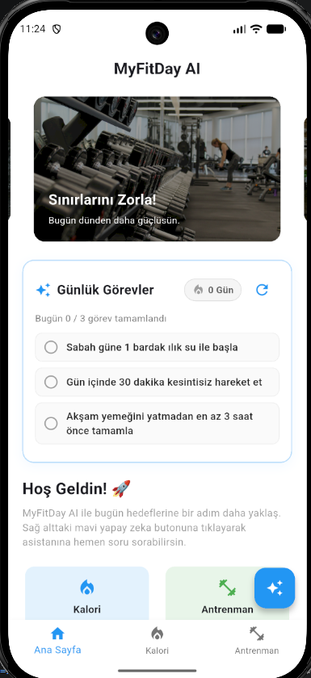
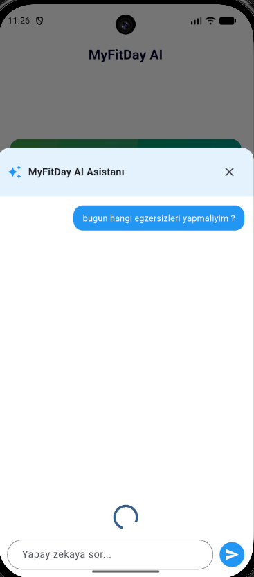
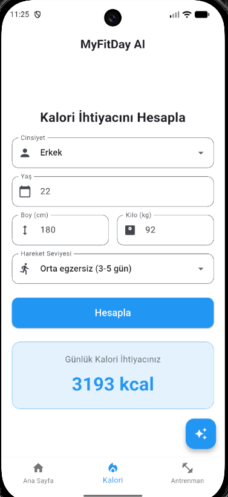
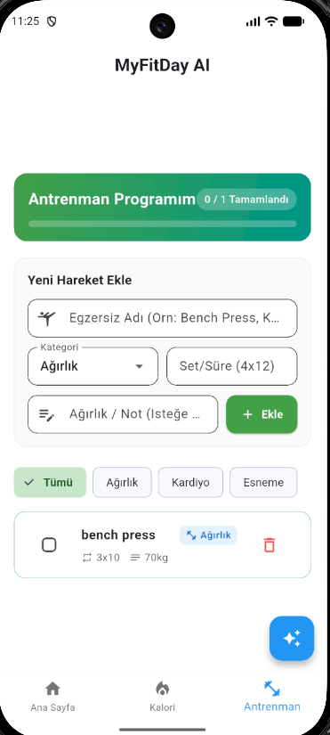

<div align="center">

# 📱 MyFitDay AI — Mobil Sağlık ve Antrenman Asistanı

**Flutter & Google Gemini AI Destekli Kişisel Fitness, Kalori ve Alışkanlık Takip Uygulaması**


</div>

---

## 📌 Proje Hakkında

**MyFitDay AI Mobile**, kullanıcıların günlük kalori ihtiyaçlarını bilimsel formüllerle hesaplamasını, kişisel antrenman programlarını kategorize ederek takip etmesini ve **Google Gemini AI** destekli sağlık koçu ile etkileşime geçmesini sağlayan çapraz platform (Android/iOS) bir mobil uygulamadır. Arka planda Node.js & Express tabanlı REST API ile haberleşir ve kullanıcı verilerini yerel depolamada (`SharedPreferences`) kalıcı olarak saklar.

---

## ✨ Öne Çıkan Özellikler

* 🤖 **AI Günlük Görevler & Seri (Streak) Sistemi:** Yapay zeka tarafından her gün otomatik üretilen 3 sağlıklı yaşam görevi ve görevler tamamlandıkça artan günlük seri sayacı.
* 💬 **Etkileşimli AI Sağlık Asistanı:** Sağ alttaki aksiyon butonu ile açılan modern sohbet penceresi üzerinden beslenme ve spor sorularına anlık yapay zeka yanıtları.
* 🔥 **Harris-Benedict Kalori Hesaplayıcı:** Yaş, boy, kilo, cinsiyet ve aktivite seviyesine göre günlük bazal metabolizma hızı (BMR) ve kalori ihtiyacını hesaplayan modül.
* 🏋️‍♂️ **Kapsamlı Antrenman Günlüğü:** Ağırlık, Kardiyo ve Esneme kategorilerinde hareket ekleme, set/tekrar/ağırlık notu tutma, kategori filtreleme ve günlük tamamlanma ilerleme çubuğu.
* 💾 **Kalıcı Yerel Depolama:** Antrenman kayıtları, günlük görev durumları ve streak verileri uygulama kapatılsa dahi cihaz hafızasında korunur.

---

## 📸 Uygulama Ekran Görüntüleri

| Ana Sayfa & AI Günlük Görevler | Yapay Zeka Sağlık Asistanı |
| :---: | :---: |
|  |  |

| Kalori İhtiyacı Hesaplama | Antrenman Programı & İlerleme |
| :---: | :---: |
|  |  |

---

## 📂 Proje Dizini

```text
myfitday-mobile/
├── screenshots/                    # Uygulama ekran görüntüleri
│   ├── anasayfa.png
│   ├── ai_asistan.png
│   ├── kalori.png
│   └── antrenman.png
├── lib/
│   ├── models/                     # Veri modelleri
│   ├── screens/                    # Uygulama ekranları ve alt modüller
│   │   ├── home_screen.dart        # Ana iskelet ve alt navigasyon menüsü
│   │   ├── home_content.dart       # Slider, AI günlük görevler ve streak kartı
│   │   ├── ai_chat_sheet.dart      # Gemini AI sohbet penceresi
│   │   ├── calorie_content.dart    # Kalori hesaplama ekranı
│   │   └── workout_content.dart    # Antrenman günlüğü ve ilerleme takibi
│   ├── services/
│   │   └── ai_service.dart         # Node.js / Gemini API bağlantı servisi
│   ├── widgets/                    # Yeniden kullanılabilir arayüz bileşenleri
│   └── main.dart                   # Uygulama giriş noktası
├── pubspec.yaml                    # Flutter paket bağımlılıkları
└── README.md                       # Proje dokümantasyonu
```

---

## 🚀 Kurulum ve Çalıştırma

1. **Depoyu bilgisayarınıza indirin:**
   ```bash
   git clone [https://github.com/srdrefe/myfitday-mobile.git](https://github.com/srdrefe/myfitday-mobile.git)
   cd myfitday-mobile
   ```

2. **Bağımlılıkları yükleyin:**
   ```bash
   flutter pub get
   ```

3. **Backend Bağlantısını Kontrol Edin:**
   `lib/services/ai_service.dart` dosyasındaki `baseUrl` adresinin (`http://10.0.2.2:3000/api/ai`) çalışan Node.js sunucunuza yönlendiğinden emin olun.

4. **Uygulamayı Başlatın:**
   ```bash
   flutter run
   ```